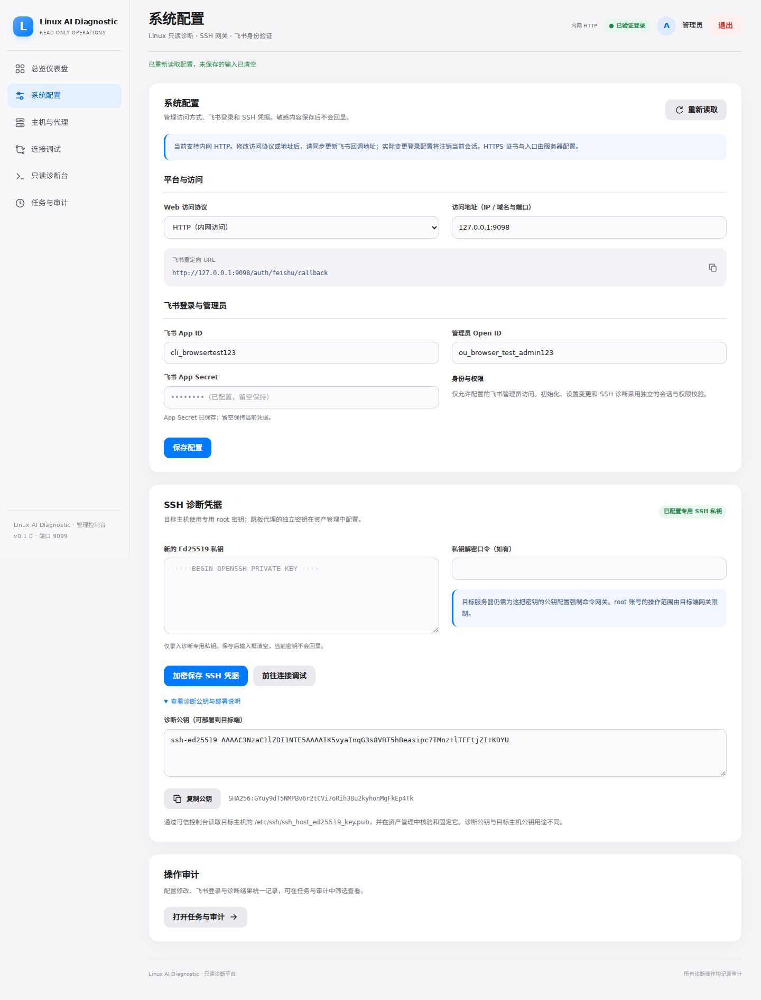
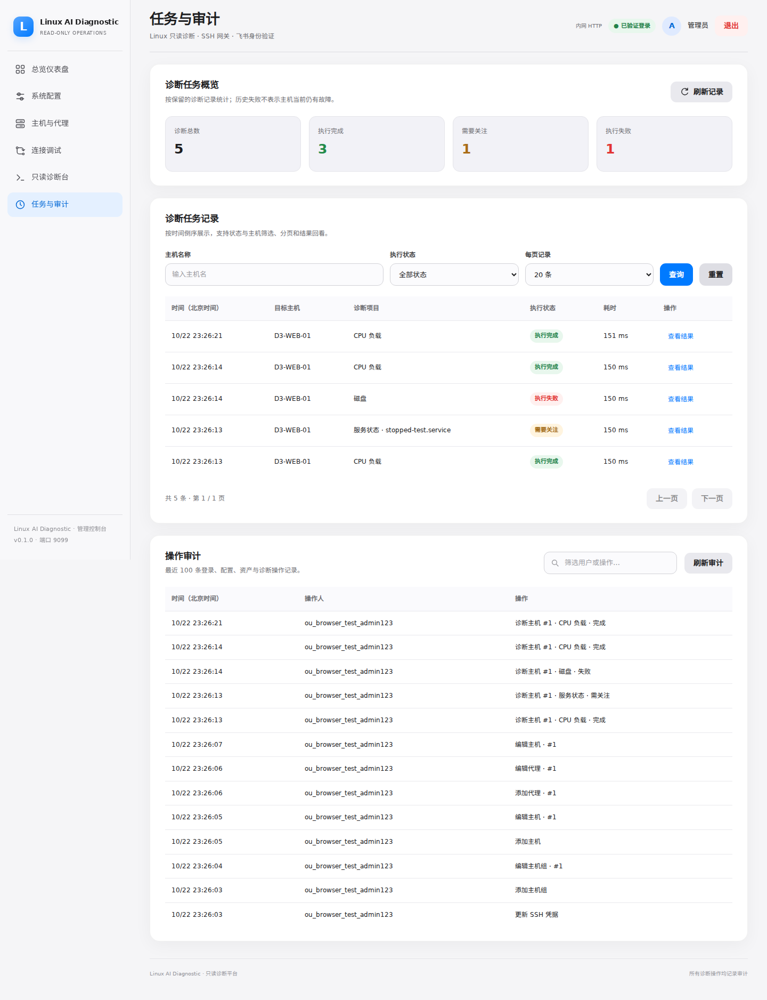

# Linux AI Diagnostic MCP

[](https://github.com/beijing10000-boop/linux-ai-diagnostic-mcp/actions/workflows/ci.yml)

**面向内网运维的 Linux 只读诊断与 MCP 平台。** 用中文桌面控制台管理主机、主机组与 SSH 跳板，通过固定诊断动作查询服务器状态，并保留加密结果与操作审计。支持飞书管理员登录，业务配置全部在 Web 中完成。

- **内网 HTTP 即可使用**：默认端口 **9099**，提供 Docker Compose 安装；也支持 HTTPS 反向代理。
- **查询结果可追溯**：CPU、内存、磁盘、网络、连接、进程与指定服务状态；记录状态、耗时、输出和错误。
- **支持 AI 工具调用**：通过本地 MCP stdio 提供主机列表和固定诊断动作，供可信 MCP 客户端接入。
- **桌面操作流程统一**：参考 [zabbix-ai-ops](https://github.com/beijing10000-boop/zabbix-ai-ops) 的导航、配置和调试流程；支持深浅色主题。

当前为 **v0.1.0 内测版本**。自动化测试已覆盖 Web、SSH 跳板、网关和 MCP；真实飞书租户及生产主机仍需部署方验证。项目没有内置 AI 对话、主动回连 Agent 或公网 MCP HTTP 服务。


## 功能与页面

| 页面 | 用途 |
|---|---|
| 总览 `/` | 实际配置、任务统计、最近诊断；点击状态卡查看明细 |
| 系统配置 `/settings` | 访问地址、飞书身份、SSH 私钥与诊断公钥；敏感凭据不回显 |
| 主机与代理 `/inventory` | 主机组、主机、跳板的新增、编辑、搜索和删除；固定 SSH 主机公钥 |
| 连接调试 `/connections` | 检查准备情况，执行一次真实 CPU 查询并保存记录 |
| 只读诊断台 `/diagnostics` | 选择主机与固定查询项目；文本/JSON 输出、复制、最近结果 |
| 任务与审计 `/activity` | 按主机或状态筛选、分页、回看加密结果、搜索操作审计 |

诊断历史最多保留 **500 次**。服务未启动、输出截断显示“需要关注”；SSH 连接异常、缺少目标命令和执行超时显示“失败”。“配置完整”只表示配置已准备，实际连通性以查询结果为准。

## 内网 HTTP 安装

准备 Linux、Docker Engine 与 Docker Compose，以及飞书自建应用的 App ID、App Secret 和管理员 Open ID（`ou_...`）。在服务器上运行：

```bash
git clone https://github.com/beijing10000-boop/linux-ai-diagnostic-mcp.git
cd linux-ai-diagnostic-mcp
mkdir -p data
sudo chown 10001:10001 data
sudo chmod 700 data
docker compose -f compose.lan.yaml up -d --build
docker compose -f compose.lan.yaml exec web cat /app/data/bootstrap.token
```

1. 浏览器打开 `http://服务器内网IP:9099`。
2. 输入一次性初始化凭证、飞书应用凭据、管理员 Open ID；访问地址填写同一个内网地址。
3. 在飞书开发者后台添加精确回调地址 `http://服务器内网IP:9099/auth/feishu/callback`，然后使用飞书登录。
4. 在“系统配置”保存诊断专用 SSH 私钥，部署下文网关，再登记主机并进行连接调试。

**无需编辑 `.env`。** 浏览器需能访问内网地址；服务器需能出网访问飞书 HTTPS 接口。HTTP 支持私有 IPv4、IPv6 ULA 与本机回环地址，传输不加密，仅在受信任内网使用。LAN 入口发布 `0.0.0.0:9099`，防火墙应只放行所需内网来源。

`compose.lan.yaml` 和默认的 `compose.yaml` 共用 `compose.common.yaml`。默认入口仅绑定 `127.0.0.1:9099`，供本机 HTTPS 反向代理使用，配置示例见 [部署说明](docs/DEPLOYMENT.md)。启动、日志和升级时使用相同入口，不叠加两个入口文件。

## 与 Zabbix AI Ops 同机部署

| 项目 | 默认宿主机端口 | 数据目录 |
|---|---|---|
| zabbix-ai-ops | 8088 | 由该项目单独管理 |
| Linux AI Diagnostic MCP | 9099 | 本仓库的 `./data` |

两个仓库放在不同目录，分别启动 Compose、保留各自凭据与飞书回调即可。若现有安装已修改端口，以实际监听为准；变更本项目的宿主机端口时，同步修改 Web 访问地址和飞书回调。

## 目标主机与 SSH 网关

每台目标 Linux 需要 sshd、`/usr/bin/python3` 和相应诊断工具。使用单独生成的 Ed25519 密钥，在 Web 中保存私钥，再复制页面显示的诊断公钥。

将本仓库的网关文件传到目标机，以 root 安装：

```bash
install -o root -g root -m 0755 gateway/ai-diagnostic-gateway /usr/local/sbin/ai-diagnostic-gateway
```

在目标机 root 的 `authorized_keys` 中添加专用公钥条目：

```text
from="DIAGNOSTIC_SOURCE_IP",restrict,command="/usr/local/sbin/ai-diagnostic-gateway" ssh-ed25519 YOUR_DIAGNOSTIC_PUBLIC_KEY ai-diagnostic
```

将 `DIAGNOSTIC_SOURCE_IP` 替换为目标实际看到的连接来源：直连时为诊断服务器，经过跳板时为跳板出口。通过可信渠道读取目标 `/etc/ssh/ssh_host_ed25519_key.pub`，核验后填入 Web 主机表单。

root 的权限限制依赖这条强制命令授权和网关；部署后应验证专用密钥只能执行固定动作，不能打开 Shell、传文件或转发端口。跳板使用独立账号、密钥和精确转发授权，见 [跳板配置](docs/PROXY_DESIGN.md)。

## MCP 接入

让可信 MCP 客户端启动以下 stdio 进程，工作目录设为本仓库：

```bash
docker compose -f compose.lan.yaml exec -T web python -m app.mcp_server
```

默认本机反向代理安装省略 `-f compose.lan.yaml`。可用工具为 `list_linux_hosts` 和 `diagnose_linux_host`，与 Web 共用主机、公钥核验、动作白名单、历史和审计。MCP 进程拥有调用已配置主机的权限，依靠操作系统/容器访问控制；不提供每个 AI 调用者的独立身份或任意 Shell、SFTP 能力。

## 数据与升级

凭据及诊断结果加密保存在 `data/inventory.db`，解密根密钥为 `data/master.key`。两者必须一起备份，限制目录权限；主密钥丢失将无法解密原数据。不要将 `data/` 或真实凭据提交到仓库。

在维护窗口停止容器并完成受保护的备份后，更新已有内网安装：

```bash
git switch main
git pull --ff-only
docker compose -f compose.lan.yaml up -d --build
docker compose -f compose.lan.yaml ps
```

现有配置和主机数据保留，启动时补齐所需表和旧代理字段。旧代理须在 Web 中补全连接配置；目标端也应重新安装仓库中的最新版网关。完整步骤及 HTTPS 配置见 [部署说明](docs/DEPLOYMENT.md)。

## 开发与验证

```bash
python -m venv .venv
.venv/bin/pip install -r requirements-dev.txt
.venv/bin/pytest -q
.venv/bin/ruff check . --select E4,E7,E9,F
npm ci
npm run check:web
npx playwright install --with-deps --only-shell chromium
npm run test:ui
DIAG_UI_PROTOCOL=http npm run test:ui
```

浏览器回归使用临时数据库、测试身份及诊断夹具，检查初始化、权限、资产管理、结果状态、历史、复制与六个桌面页面（1280 / 1440 / 1920 宽度、深色主题）。真实 Paramiko 测试另行验证 SSH 握手、双端公钥固定、跳板转发和超时释放；MCP 使用真实 stdio 协议测试。GitHub Actions 同时检查 Python 3.11/3.12、HTTP/HTTPS 浏览器流程与 Docker 启动，并保存截图。





更多说明：[飞书认证](docs/FEISHU_SETUP.md) · [安全说明](SECURITY.md) · [实现范围](docs/SSH_MCP_UPSTREAM.md) · [更新日志](CHANGELOG.md)
