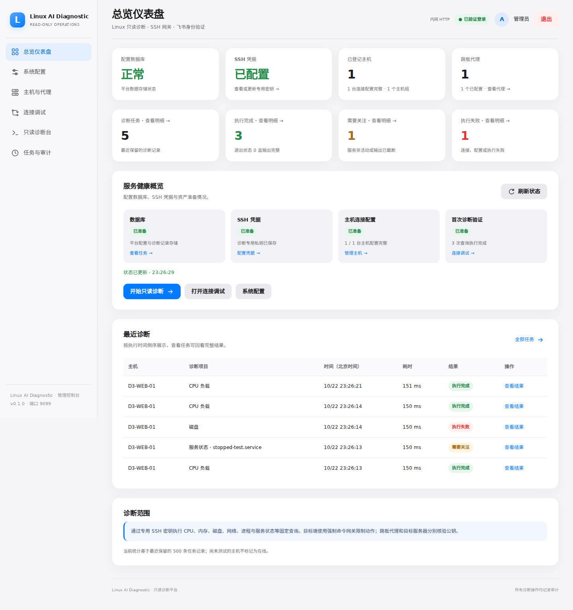

# Linux AI Diagnostic MCP

[](https://github.com/beijing10000-boop/linux-ai-diagnostic-mcp/actions/workflows/ci.yml)

**v0.1.0 · 内测基线** — 中文 Web、飞书 OAuth 管理员身份、SSH 限制诊断、主机组、代理资产管理、安全审计与本地 MCP stdio 工具。

> **安全提醒：当前版本未完成真实飞书租户/生产服务器的端到端验证，不允许直接公网开放 9099 或接入生产 root 密钥。** 当前代理通过 SSH 跳板通道执行诊断；主动回连 Agent 尚未实现。上游 classfang 的任意 Shell / SFTP / Job 不开放。

## 核心功能

| 功能 | 状态 |
|---|---|
| 飞书 Open ID 管理员登录 / 首次初始化 | 实现基础功能，待真实应用验证 |
| 加密的 Web 配置 / SSH Ed25519 私钥 | 已实现 |
| 主机组 / 主机 / 代理管理 | 支持新增、编辑、删除、搜索与分组筛选 |
| SSH 跳板代理 | 独立凭据、双端公钥核验、目标端口转发 |
| 诊断历史 | 加密保存最近 500 次记录，Web 展示最新 8 条，摘要 API 返回最近 50 条 |
| 只读 SSH 固定动作 / 强制命令 | 已实现；需目标端安装网关 |
| MCP 标准工具（stdio） | 已实现，本地受信任进程可运行 |
| 公网 MCP HTTP、SFTP、任意 Shell | 明确禁用 |
| 诊断审计、CSRF、Host / Origin 校验 | 已实现基础防护 |

## 内网 HTTP 安装

在私有网络中可直接使用 `http://服务器内网IP:9099`。无需 Nginx 或证书，飞书管理员登录、CSRF、Host 校验和命令白名单继续生效。

```bash
mkdir -p data
sudo chown 10001:10001 data
sudo chmod 700 data
docker compose -f compose.lan.yaml up -d --build
docker compose -f compose.lan.yaml exec web cat /app/data/bootstrap.token
```

浏览器打开 `http://服务器内网IP:9099`，初始化时“访问地址”填写相同地址。飞书开发者后台的重定向 URL 填写 `http://服务器内网IP:9099/auth/feishu/callback`。浏览器必须能访问该内网地址，服务器仍需出网访问飞书 HTTPS 接口。

`compose.lan.yaml` 是独立配置文件，发布 `0.0.0.0:9099`；网络边界只向内网放行该端口。HTTP 不加密传输，仅用于受信任内网。访问地址支持 RFC1918 IPv4、IPv6 ULA 与本机回环地址；公网访问使用 HTTPS。

## 本机内测

```bash
git clone https://github.com/beijing10000-boop/linux-ai-diagnostic-mcp.git
cd linux-ai-diagnostic-mcp
mkdir -p data
sudo chown 10001:10001 data
sudo chmod 700 data
docker compose up -d --build
docker compose exec web cat /app/data/bootstrap.token
```

默认 **9099**，仅绑定 `127.0.0.1:9099`。首次访问请在 **受限 HTTPS 反向代理/VPN** 下进行，凭本机一次性初始化凭证填写飞书 App ID、App Secret、管理员 Open ID（ou_...）和 HTTPS 域名。飞书应用中配置 `https://你的域名/auth/feishu/callback` 为回调地址。

页面：
- `/` 诊断工作台
- `/inventory` 主机与主机组、代理资产管理
- `/settings` 飞书、SSH 私钥、安全审计
- `/healthz` 非敏感健康与版本信息

应用凭据加密保存在 `data/inventory.db`；解密根密钥保存在 `data/master.key`（0600），必须安全备份且限制目录权限。**无需编辑任何 .env 文件。** 不要把 `data/` 提交到 GitHub，也不要将私钥写入 Compose 文件或 GitHub Actions Secrets 以外的公开资料。

## SSH 诊断网关

必须在每台目标 Linux 主机上以 root 安装 `gateway/ai-diagnostic-gateway` 为 `/usr/local/sbin/ai-diagnostic-gateway`，使用 root 拥有、0755 权限，并在 root `authorized_keys` 上为专用密钥添加：

```text
from="DIAGNOSTIC_SERVER_IP",restrict,command="/usr/local/sbin/ai-diagnostic-gateway" ssh-ed25519 YOUR_DIAGNOSTIC_PUBLIC_KEY ai-diagnostic
```

新建主机时填写可信渠道核验的 `/etc/ssh/ssh_host_ed25519_key.pub` 内容。默认只有 CPU、内存、磁盘、网络、网络连接、进程和指定服务状态等查询动作。**root 本身并不只读**，安全性取决于仅允许受限公钥、强制命令和网关审计；正式使用前务必验证不可启动 Shell/上传文件。

## MCP 本地接入

```bash
docker compose exec -T web python -m app.mcp_server
```

这是供可信内部进程启动的 MCP **stdio** 服务，提供 `list_linux_hosts` 和 `diagnose_linux_host`。标准 MCP HTTP 服务、主动回连代理队列及用户级 MCP 身份认证仍在规划，**不要直接向公网开放 stdio 包装服务**。

## 控制台与诊断体验

以下截图来自隔离测试环境，主机与诊断数据为测试夹具。




- 统一导航、桌面控制台布局、随系统切换的深浅色主题。
- 主机组显示名称，资产支持搜索、分组筛选与弹窗编辑；主机可直接进入诊断。
- 诊断时防重复提交，服务项目按需显示服务名字段，连接错误提供具体排查提示。
- 标准输出与标准错误分开呈现，支持 JSON 切换、复制和历史回看；输出过大时保留已收集结果。
- 登录配置实际变化时才注销会话；更新域名后转到新的登录地址。

## 升级已有安装

备份 `data/inventory.db` 与 `data/master.key` 后更新代码并重建容器。启动时自动补齐代理字段和诊断历史表，原有主机、组、飞书配置和 SSH 凭据保留。旧代理保持“待配置”，请在 Web 中补齐后使用。

目标端的命令网关也有更新：解决命令路径差异并限制子进程输出。请按部署说明重新安装 `gateway/ai-diagnostic-gateway`。默认端口继续为 **9099**。

## 开发验证

```bash
python -m venv .venv
.venv/bin/pip install -r requirements-dev.txt
.venv/bin/pytest -q
.venv/bin/ruff check . --select E4,E7,E9,F
npm ci
npx playwright install --with-deps chromium
npm run test:ui
```

浏览器测试使用独立临时数据库、测试身份与 HTTPS 服务器，覆盖初始化、认证门禁、资产 CRUD、错误提示、诊断历史、桌面尺寸和深色布局。其诊断结果为测试夹具；SSH 握手与跳板转发由另外的真实 Paramiko 连接测试覆盖。GitHub Actions 会保存页面截图供复核。

详见 [跳板代理配置](docs/PROXY_DESIGN.md)、[部署说明](docs/DEPLOYMENT.md)、[飞书认证](docs/FEISHU_SETUP.md)、[安全说明](SECURITY.md)、[更新日志](CHANGELOG.md)。
